# ☸️ TP14 : Déploiement et Administration d'un Cluster Kubernetes avec K3s

## 📝 Présentation du projet
Ce dépôt contient l'intégralité du TP14. L'objectif était de déployer un cluster Kubernetes multi-nœuds léger avec **K3s** (via Vagrant et Ansible), puis d'explorer les objets Kubernetes fondamentaux (Deployments, Services, Ingress, ConfigMaps, Secrets, PVC, HPA) sur une application de démonstration.

## 📂 Structure du Dépôt
- 📁 `k3s-lab/` : Infrastructure as Code (Vagrantfile, playbook et rôles Ansible).
- 📁 `k8s-starter/` : Manifestes YAML de l'application.
- 📁 `captures_ecran/` : Preuves visuelles de validation du TP.
- 📄 `rapport_tp14.pdf` : Rapport détaillé avec les réponses théoriques.

---

## 🚀 Validation des étapes (Livrables)

<b>Partie 1 : Cluster K3s avec Vagrant + Ansible (Cliquez pour voir)</b>

 

**Vérification du cluster (2 nœuds Ready) et des pods système :**
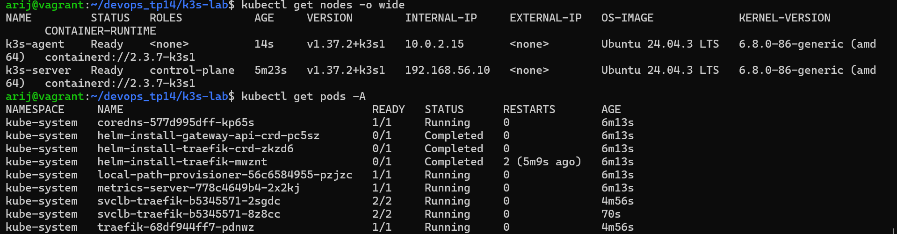

**Recréation du cluster complet (destroy & up) :**
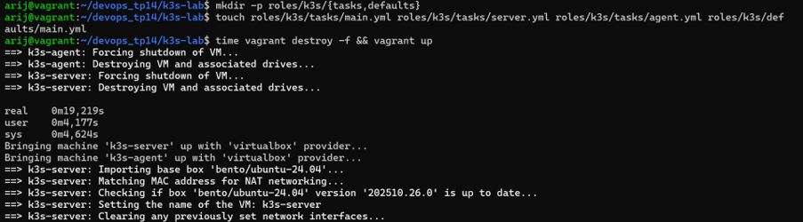
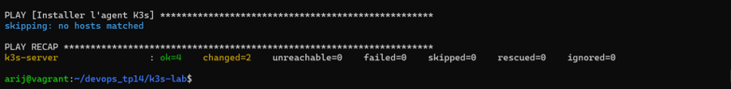

<b>Partie 2 : Pods et Deployments (Cliquez pour voir)</b>

 

**Création manuelle d'un Pod et suppression :**
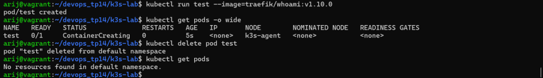
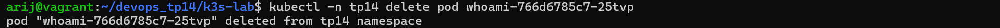

**Application du Deployment et auto-réparation (recréation du pod) :**
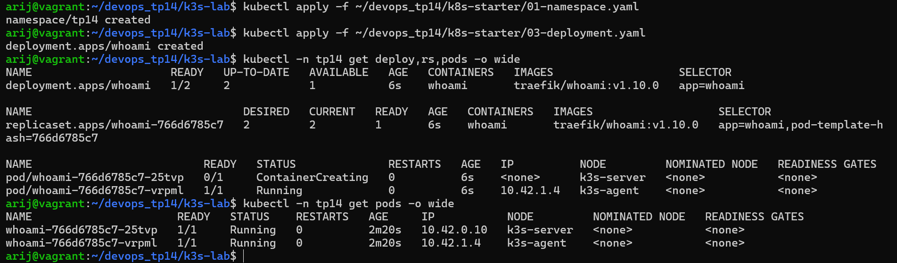
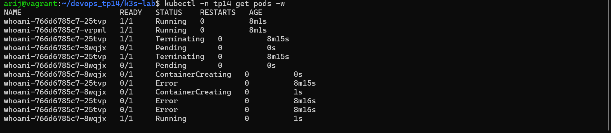

**Exploration (describe, logs, exec) :**
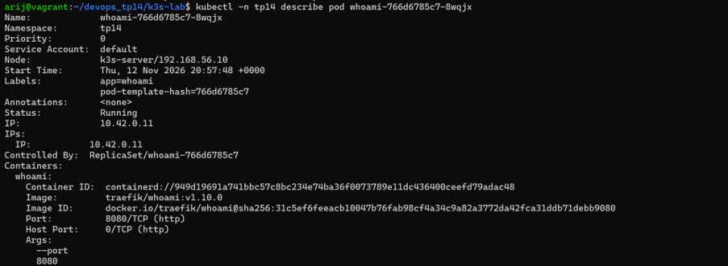
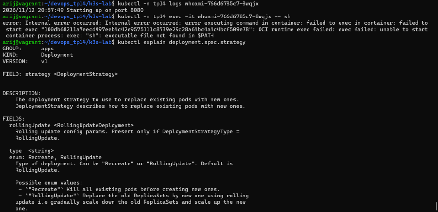

<b>Partie 3 : Services et Ingress (Cliquez pour voir)</b>

 

**Vérification du Service ClusterIP et des Endpoints :**
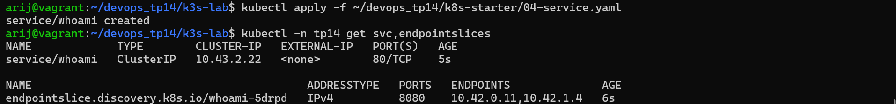

**Test de résolution DNS interne au cluster :**
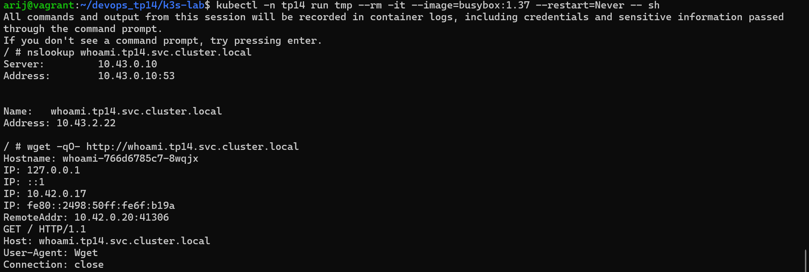

<b>Partie 4 : ConfigMap et Secret (Cliquez pour voir)</b>

 

**Injection des variables d'environnement (ConfigMap/Secret) dans l'application :**
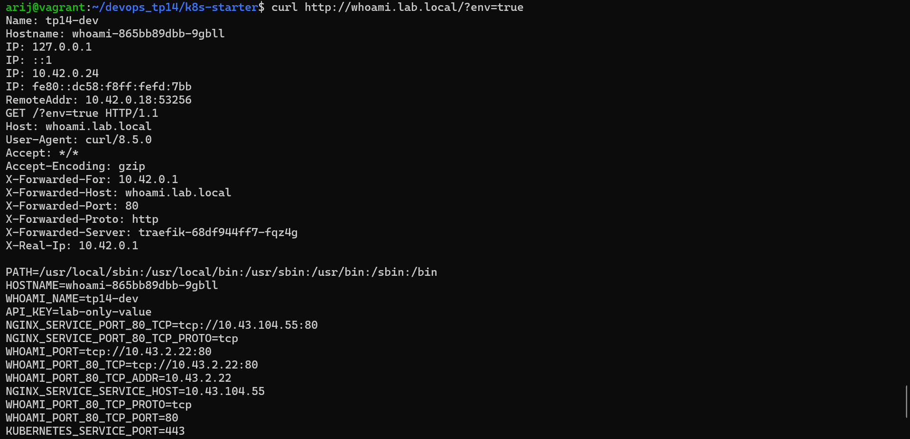

<b>Partie 5 : Santé, ressources et déploiements progressifs (Cliquez pour voir)</b>

 

**Test de la LivenessProbe (simulation de panne 500 et redémarrage) :**
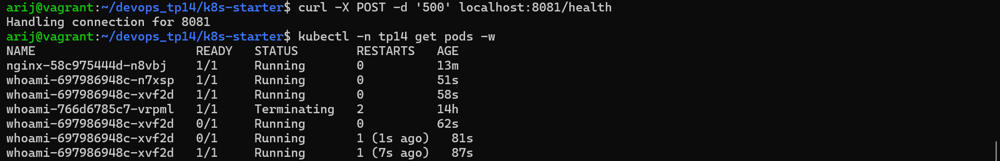

**Rolling Update, échec (ImagePullBackOff) et Rollback :**
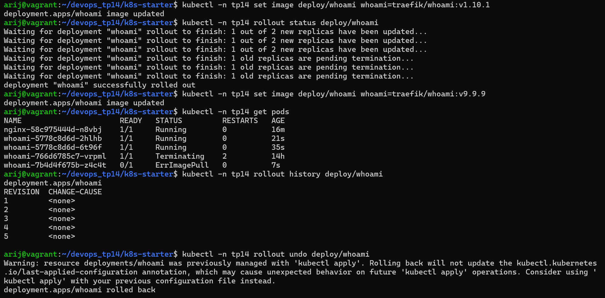

**Test de dépassement de mémoire (OOMKilled) et restauration :**
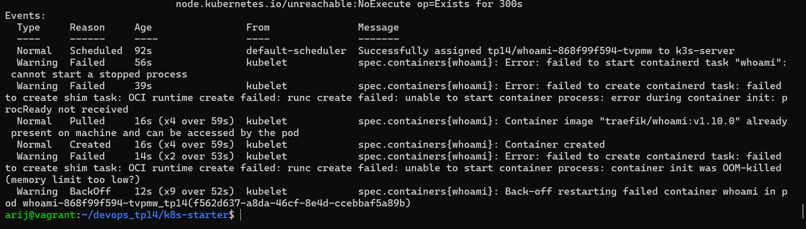
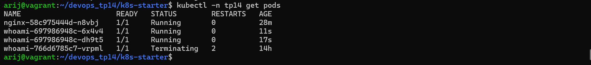

<b>Partie 6 : Stockage persistant (Cliquez pour voir)</b>

 

**Preuve de persistance des données PostgreSQL après suppression du Pod :**
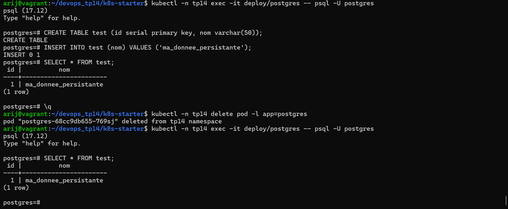

<b>Partie 7 : HorizontalPodAutoscaler (Cliquez pour voir)</b>

 

**Mise à l'échelle automatique (HPA) : Montée du CPU et augmentation des replicas :**
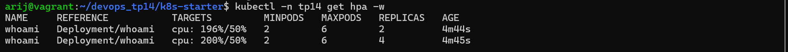

---

## 🔒 Sécurité et Bonnes Pratiques
Conformément aux règles de sécurité DevOps :
- Le dossier `.vagrant/` (contenant les clés SSH privées) est exclu via le `.gitignore`.
- Le fichier `k3s.yaml` (kubeconfig) n'est pas versionné.
- Les Secrets ne sont pas écrits en dur dans les fichiers YAML.
